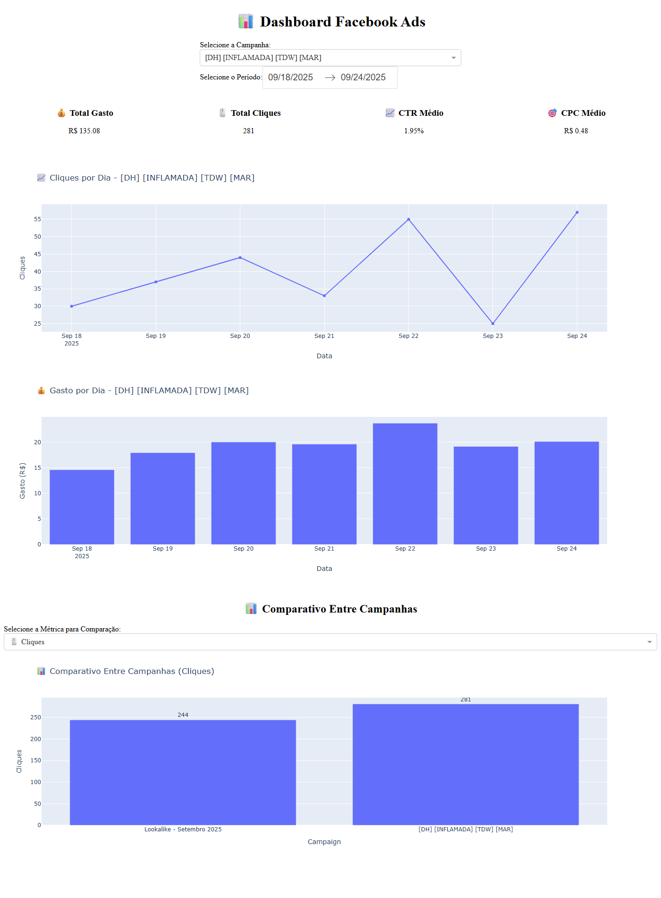

# 📊 Dashboard de Performance — Facebook Ads

Dashboard interativo em Python (**Dash + Plotly**) para acompanhar e comparar o desempenho de campanhas de Facebook Ads a partir do relatório exportado da plataforma.

➡️ **[Acessar o dashboard online](https://marketing-analytics-dashboard.onrender.com)**



## 🎯 Problema de negócio
Quem gerencia anúncios precisa responder rápido a perguntas como:
- Qual campanha traz cliques mais baratos?
- Qual público responde melhor ao anúncio (CTR)?
- Como o investimento e os resultados evoluem dia a dia?

O relatório bruto do Gerenciador de Anúncios dificulta essa leitura. Este dashboard centraliza os indicadores, com filtros por campanha e período.

## 🔎 Principais insights (18 a 24/09/2025)

| Campanha | Impressões | Cliques | Gasto | CTR | CPC |
|---|---:|---:|---:|---:|---:|
| Lookalike - Setembro 2025 | 9.651 | 244 | R$ 98,81 | **2,53%** | **R$ 0,40** |
| [DH] [INFLAMADA] [TDW] [MAR] | 14.429 | 281 | R$ 135,08 | 1,95% | R$ 0,48 |
| **Total** | **24.080** | **525** | **R$ 233,89** | **2,18%** | **R$ 0,45** |

1. **O público Lookalike é mais eficiente.** Ele teve CTR cerca de 30% maior e CPC cerca de 16% menor que a outra campanha.
2. **O Lookalike teve entrega irregular.** Foram só 46 impressões em 20/09 e nenhuma em 21 e 22/09. Mesmo assim, ele registrou os melhores dias do período (até 104 cliques em 24/09).
3. **Nenhuma conversão foi registrada** (leads, compras ou conversas no WhatsApp) em 525 cliques. Isso pode indicar falha de rastreamento (pixel ou eventos) ou um problema na página de destino.

**Recomendações:** priorizar verba no Lookalike, investigar por que a entrega dele foi interrompida e validar o rastreamento de conversões antes de escalar o investimento.

## ⚙️ Funcionalidades
- Filtros por **campanha** e **período**
- KPIs: Gasto total, Cliques, CTR e CPC do período
- Gráficos de cliques e gasto por dia
- Comparativo entre campanhas, com a métrica escolhida (Cliques, Gasto, CTR ou CPC)

## 📐 Como as métricas são calculadas
As taxas são calculadas sobre os **totais do período**, e não como média das taxas diárias:

- **CTR** = total de cliques ÷ total de impressões × 100
- **CPC** = gasto total ÷ total de cliques

A média simples dos valores diários dá o mesmo peso a um dia com 46 impressões e a um dia com 3.558, o que distorce o resultado. Neste conjunto de dados, ela indicaria um CPC de R$ 0,49 para o Lookalike, quando o valor real é R$ 0,40.

## 🛠️ Tecnologias
- **Python** e **Pandas**: leitura e tratamento dos dados
- **Dash** e **Plotly**: interface e gráficos interativos
- **Openpyxl**: leitura do relatório em Excel
- **Render**: publicação online

## ▶️ Como executar
```bash
pip install -r requirements.txt
python dashboard_facebook_ads.py
```
Depois, acesse `http://localhost:8050`. Para ativar o modo de depuração, defina a variável de ambiente `DASH_DEBUG=true`.

## 📂 Estrutura do projeto
```
├── dashboard_facebook_ads.py              # aplicação Dash
├── relatorio_facebook_ads_2025-09-25.xlsx # dados usados pelo dashboard
├── relatorio_facebook_ads_2025-09-17.xlsx # extração anterior
├── requirements.txt
└── images/dashboard.png
```
